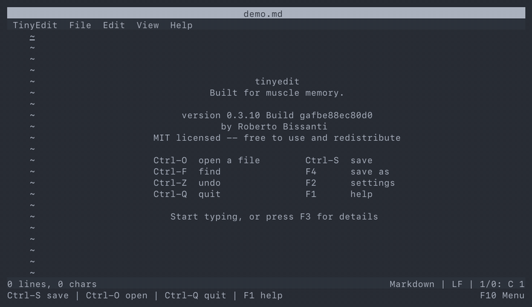
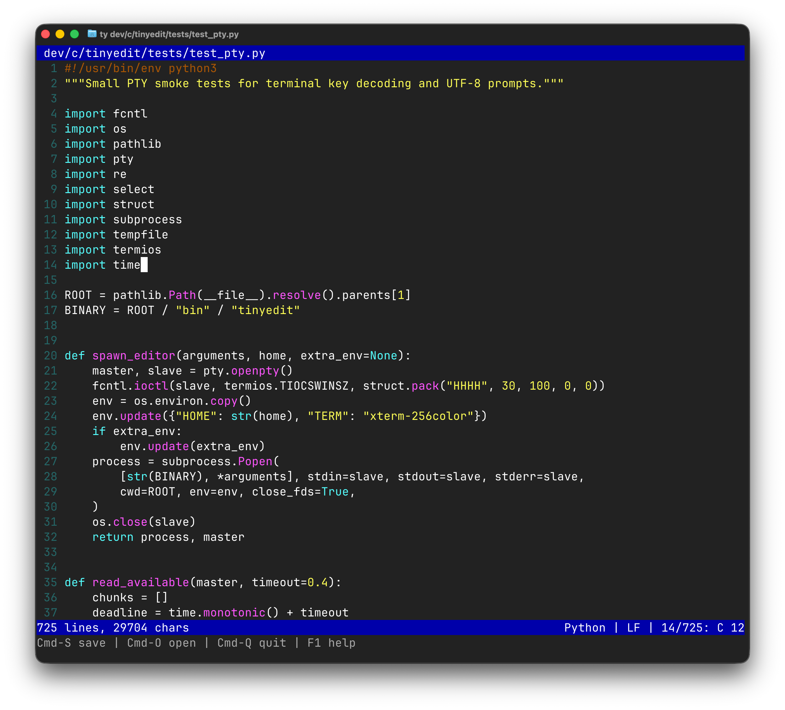
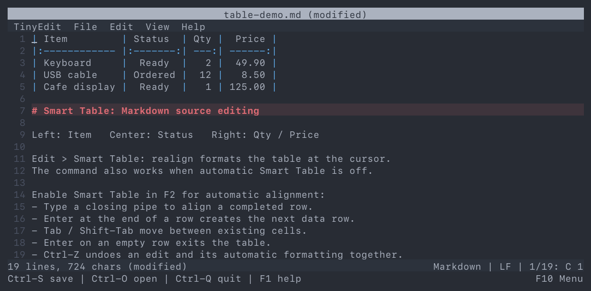

<div align="center">


# tinyedit

[](https://github.com/robertobissanti/tinyedit/releases)
[](LICENSE)
[](#build)
[](https://github.com/robertobissanti/tinyedit/releases)
[](#build)
[](#build)
[](https://github.com/robertobissanti/tinyedit)
[](https://github.com/robertobissanti/tinyedit)
[](https://deepwiki.com/robertobissanti/tinyedit)

</div>

A small full-screen terminal text editor written in plain C (kilo-style,
after [kilo](https://github.com/antirez/kilo) by Salvatore Sanfilippo),
with no dependencies beyond the POSIX standard library.

tinyedit brings the familiar ease of a desktop text editor to the terminal.
It uses the terminal's alternate screen while open, then returns to the main
screen on exit with the shell prompt and scrollback intact.

Traditional terminal editors can require learning modal editing (Vim),
memorizing non-standard key sequences (Emacs), or working around limited
navigation and selection (Nano). tinyedit reduces that friction with familiar
shortcuts such as `Ctrl-C`, `Ctrl-V`, `Ctrl-Z`, and `Ctrl-F`, Shift+Arrow text
selection, and optional mouse support for clicking and scrolling.

<div align="center">



</div>

## Contents

- [Why it exists](#why-it-exists)
- [Features at a glance](#features-at-a-glance)
- [Homebrew](#homebrew-macos--linux)
- [Build and build identification](#build)
- [Usage and installation](#usage)
- [Quick reference](#quick-reference)
- [Markdown editing and navigation](#markdown-editing-and-navigation)
- [Documentation](#documentation)
- [Project status](#project-status)
- [Author and license](#author-and-license)

[Back to top](#tinyedit)

## Why it exists

I kept building tinyedit because I became convinced that a terminal editor
could be simple enough to use every day. While implementing it, I paid close
attention to carrying over the mouse gestures and keyboard shortcuts people
already know from desktop text editors and word processors. The goal is not
to invent another editing language: it is to make opening a terminal file
feel immediately familiar.

There is still room to grow, such as adding multiple buffers to keep several
files open in one session. Future additions will be evaluated carefully to
keep the editor simple and focused.



*Python source in tinyedit, with line numbers, soft wrapping, file statistics,
and configurable syntax colors.*

[Back to top](#tinyedit)

## Features at a glance

tinyedit is intentionally small, but it is meant to be comfortable enough
for real editing rather than just demonstrating how a terminal works.

- [Editing](docs/usage.md#keyboard-shortcuts): Familiar cursor movement, word
  jumps, selection, cut/copy/paste, automatic indentation, block
  indent/outdent with Tab, configurable pair and XML/HTML tag closing,
  matching-bracket highlighting, and an undo history of up to 2,000 steps (200
  by default).

- [Files](docs/usage.md#opening-and-closing-files): Start an empty document
  with File → New / Ctrl-N, open or switch files without restarting tinyedit,
  complete file paths with Tab, start a named file before it exists, save
  atomically, and recover named documents from optional automatic backups
  after a crash.

- [Sidebar](docs/usage.md#file-tree-sidebar): Browse a persistent filesystem
  tree with keyboard or mouse, expand folders lazily, change its root, and
  open files with protection for unsaved edits.

- [Search](docs/usage.md#find-and-replace): Incremental literal or POSIX
  regular-expression search, match navigation, and interactive search and
  replace.

- [Syntax highlighting](docs/syntax-highlighting.md#syntax-highlighting):
  Built-in support for C/C++, Python, Shell, JavaScript/TypeScript, Markdown,
  HTML/XML, CSS, and JSON, including function names. Simple C-like languages
  and HTML-based templates (Nunjucks, Jinja, Liquid, Twig) can be added with a
  user configuration file; ready-made ones ship in `syntax-configs/`.

- [Markdown](#markdown-editing-and-navigation): Optional live preview,
  heading/Pandoc/Obsidian navigation, local `@id` references, image opening in
  the default desktop app, and language highlighting inside fenced code
  blocks.

- [UTF-8](docs/usage.md#utf-8-text): Cursor movement, deletion, display width,
  wrapping, and character counts understand combining marks, CJK text, and
  multi-code-point emoji.

- [Long lines](docs/usage.md#soft-wrapping-and-navigation): Lines wrap at the
  terminal edge, preferably at word boundaries. Navigation follows the visible
  wrapped rows, without imposing a fixed line-length limit.

- [Clipboard](docs/usage.md#keyboard-shortcuts): Uses the native macOS
  clipboard or the available Wayland/X11 clipboard tool directly, without
  sending commands through a shell.

- [Terminal input](docs/usage.md#mouse-support): Fast bracketed paste,
  optional mouse selection and scrolling, and key-sequence handling for common
  macOS and Linux terminals. Wheel scrolling keeps the viewport in place
  during pointer movement even when the cursor is off-screen.

- [Menus](docs/usage.md#menus): A persistent menu bar with TinyEdit, File,
  Edit, View, and Help menus; keyboard and optional mouse navigation;
  shortcuts beside commands; and checked View settings.

- [Interface](docs/usage.md#top-and-status-bars): Optional Markdown live
  preview with cursor expansion, line numbers and top bar, visible whitespace,
  file statistics, in-editor help, and a settings panel.

- [Configuration](docs/configuration.md#settings-and-appearance): Settings
  live in `~/.tinyeditrc`; tabs, wrapping, mouse behavior, cursor shape and
  blinking, interface elements, and editing assists can all be changed from
  `F2`.

- [Colors and themes](docs/configuration.md#colors-page-and-rgb): ANSI by
  default or optional RGB with validated hex colors, previews, separate
  palettes, and One Dark plus all four Catppuccin flavors selected from one
  Colors page.

- [Build identification](#build-identification): The same release and source
  build identifier appears in `--version`, the startup splash, and F3.

- [Portability](#build): One C99 binary and no third-party runtime libraries.
  The supported targets are POSIX systems such as macOS and Linux.

- [Testing](docs/development.md#code-layout): Syntax, settings, backup,
  terminal-input, key-binding, and very-long-line behavior are covered by
  `make test`; sample files are included for hands-on checks.


Settings can be changed from the built-in `F2` panel or by editing
`~/.tinyeditrc`, which tinyedit creates automatically on first launch.

The project also remains an exploration of how terminal interfaces work from
scratch: raw mode, ANSI escape sequences, input decoding, and manual redraw,
without reaching for a TUI framework. Its first prototype used
[linenoise](https://github.com/antirez/linenoise) for a command-driven line
editor. The current version is a true full-screen editor with a freely moving
cursor; linenoise remains in the repository for historical reference but is
not a build dependency.

[Back to top](#tinyedit)

## Homebrew (macOS / Linux)

If you use Homebrew on macOS or Linux, install tinyedit with

```sh
brew install robertobissanti/tinyedit/tinyedit

```

[Back to top](#tinyedit)

## Build

```sh
make        # produces the bin/tinyedit binary
make clean  # removes it
```

Needs only a C99 compiler and a POSIX system (macOS or Linux).

[Back to top](#tinyedit)

### Build identification

`bin/tinyedit --version`, the startup splash and F3 display the same complete
version and build identifier. Git builds use `g` plus twelve commit digits;
local source changes add `-dirty-s<checksum>`. Archives without Git use
`source-s<checksum>`. The POSIX checksum covers source/header files, the
Makefile and build generator; it is not cryptographic and collisions are possible.
Identical sources retain the same ID; compiler, flags and platform are not encoded.
The generated header is checked on every make, without requiring make clean.
The application is rebuilt each time, including on make implementations with
coarse timestamp resolution; unchanged generated header content is retained.
Packagers may override it with `make BUILD_ID=package-0.3.10-r1` (up to 120
letters, digits, dots, underscores, plus signs or hyphens). The packager owns
the accuracy and uniqueness of this override.

[Back to top](#tinyedit)

## Usage

```sh
bin/tinyedit [file-or-folder]
bin/tinyedit --version  # print version and build ID without starting the editor
```

Pass a folder to start an empty unnamed document with that folder as the
visible sidebar root and the base for relative Open/Save paths. Keyboard focus
starts in the document.

[Back to top](#tinyedit)

### Optional command installation

The build output stays in `bin/tinyedit` without modifying your shell
configuration. To run `tinyedit` from any directory, install or symlink it
into a location in your `PATH`, such as `/usr/local/bin`:

```sh
make
sudo make install PREFIX=/usr/local
```

For an installation without administrator privileges, use
`make install PREFIX="$HOME/.local"` and add `~/.local/bin` to your `PATH`.
A permission error for `/usr/local/bin` is an installation failure; the compiled
binary remains available as `bin/tinyedit`.

`make install` installs the binary, shipped color schemes, syntax definitions,
and documentation. Shared resources live in `$(PREFIX)/share/tinyedit` (by
default `/usr/local/share/tinyedit`), so `sudo` never writes into a user's home.
Personal themes and syntax definitions in `~/.tinyedit/` take precedence.
Help → Documentation uses the shared guides unless personal guides are installed.

Use `make install-binary` for just the executable. For a custom prefix, pass the
same `PREFIX` when building and installing: the resource path is compiled into
the binary. Packagers can override `DATADIR` and stage files with `DESTDIR`;
`DESTDIR` is never part of the runtime path.

These optional commands still install personal copies; run them without `sudo`:

```sh
make install-resources      # color schemes + syntax definitions, never overwrites
make install-docs           # personal guides for Help → Documentation
```

[Back to top](#tinyedit)

## Quick reference

- `Ctrl-N` / `Ctrl-O`: New document / open file

- `Ctrl-S` / `F4`: Save / Save as

- `Ctrl-W` / `Ctrl-Q`: Close document / quit, with unsaved-change protection

- `Ctrl-Z` / `Ctrl-Y`: Undo / redo

- `Ctrl-F`: Find and replace

- `Ctrl-E`: Show or hide the file tree

- `Alt+Enter`: Follow the link or local Markdown reference under the cursor

- `F1` / `F2` / `F3`: Help / Settings / Info

- `F10`: Open the menu


F2 includes cursor shape and blinking, editing preferences, and a **Colors**
page with ANSI/RGB palettes and live previews. One Dark and all four official Catppuccin RGB palettes
(Latte, Frappé, Macchiato and Mocha) are included. The Colors page always shows the current preset name
(or Custom); Left/Right selects a preset directly in the draft, without an
extra confirmation. The RGB presets use distinct yellow parentheses and
brackets. Markdown link/image delimiters and Pandoc anchor markers use a
separate JSON-key color, distinct from ordinary parentheses and brackets.
Link labels and destinations share that color and are underlined in styled
source as well as live preview.
Strings and comments retain their own colors. Each theme gives Markdown H1–H6
six independent colors, with matching lightly tinted RGB backgrounds, editable
in Colors; older palettes inherit the
preprocessor color until updated.
Save all Settings with F2/Ctrl-S. ANSI is the default; RGB output is an explicit choice.
Synthwave Pro is also available as a dark RGB adaptation of Roberto Bissanti’s
Obsidian theme. Theme sources and adaptation limits are listed in the
[palette guide](colorschemes/README.md#theme-sources-and-terminal-adaptations).
See the [settings and themes guide](docs/configuration.md) for installation
and configuration.

[Back to top](#tinyedit)

## Markdown editing and navigation

**Smart Table** aligns editable Markdown source while preserving cell contents.
Enable it in **F2 → Smart Table** and save the settings, or set
`smart_table = true` in `~/.tinyeditrc` (off by default). Type a header such as
`| Item | Qty |`, then press Enter at its end: tinyedit aligns it, inserts the
header separator and creates the first data row.

- Type a closing pipe or complete a row with Enter to align the table.
- Use Tab / Shift-Tab to move between existing cells once the separator exists.
- Press Enter on an empty table row to return to ordinary text.
- Use **Edit → Smart Table: realign** for a one-off cleanup, even with automatic
  Smart Table disabled. Ctrl-Z undoes the edit and its formatting together.



*Actual tinyedit v0.3.10 terminal output, captured in a 96-column PTY and rendered
as PNG with the One Dark RGB theme. Item is left-aligned, Status centered, and
Qty / Price right-aligned. Markdown source remains visible and editable.*

The second row's colons select alignment (`:---`, `:---:`, `---:`). Structural
pipes and delimiter markers have their own syntax color, independently of the
Smart Table setting. Tables must have outer pipes and consistent cell counts;
wide tables retain normal wrapping. See the [illustrated Smart Table guide](docs/usage.md#smart-table)
for before/after screenshots, a copyable example, Unicode handling and limits.

Enable **View → Markdown live preview**, or the same option in F2, to hide
paired bold/italic markers and display inline links as underlined labels.
Bold and italic reveal their source at the cursor; links enter source editing
from either boundary and remain editable while you type the destination.
The original file bytes are preserved. Live preview works with syntax
highlighting on or off and is off by default. See the
[Markdown display guide](docs/usage.md#markdown-display-and-live-preview).

Use **Alt+Enter** or a mouse double-click to follow a link. With mouse support
and live preview enabled, hover changes a compact link's color and one click
opens it. Relative text-file links open inside tinyedit with the usual
save/discard/cancel protection. Web and `mailto:` links open the configured
browser or mail composer; no mail is sent by tinyedit.
tinyedit asks before opening a web or mail link in an external application.

Markdown navigation supports heading slugs, explicit Pandoc IDs on headings,
spans, images and fenced Divs, and Obsidian block IDs. For example:

```markdown
[Settings](#settings-and-appearance)
[Dati](#dati)
[Tabella](#^tabella)
[Dati in un altro file](altro.md#dati)

## Misurazioni {#dati}
[Risultato]{#risultato}
Riferimenti locali: @dati e [@risultato].

Un paragrafo identificato. ^paragrafo
```

Explicit Pandoc IDs take precedence over heading slugs and match exactly;
`#^id` searches only Obsidian blocks. Standalone Obsidian markers, separated
by blank lines, jump to their own marker line. Bare fragments such as `(#^id)`
navigate like `[label](#^id)`. Missing or duplicate
targets produce red errors; unresolved `@id` citations remain text. Code is
excluded from navigation. See the [target examples and limits](docs/usage.md#markdown-heading-attribute-and-block-targets)
for tables, lists, quoted blocks, namespaces, UTF-8 and encoded fragments.

In an image such as `{#fig:diagramma}`, the
source path opens in the default desktop application using `open` on macOS or
`xdg-open` on Linux. Hover and single-click the visible path in live preview,
or use the usual link gestures. Only non-executable raster image files with a
matching file header are offered for opening, after confirmation; SVG is
excluded. The Markdown document and unsaved changes stay
open. A link to `#fig:diagramma` instead jumps to the image's source in the
document. See [image navigation](docs/usage.md#markdown-images).

Fenced blocks with a language tag, such as an opening line `` ```c `` or
`` ~~~python ``, use the existing language highlighter, including installed
syntax definitions. Keywords, numbers, strings and multiline comments get
their normal syntax colors. Unknown or omitted languages and inline code keep
a uniform code style. See the [fenced-code guide](docs/syntax-highlighting.md#fenced-code-blocks)
for aliases, Pandoc language classes and examples. tinyedit navigates and edits
the source; it does not execute code or Pandoc, number figures or render images.

Wheel scrolling leaves the cursor stationary and keeps the viewport where you
scrolled while the pointer moves or hovers over links. Keyboard input, a text
click, dragging or an anchor jump restores cursor-following.

[Back to top](#tinyedit)

## Documentation

`make install` includes the guides and their linked resources. Open
**Help → Documentation** inside tinyedit to read them. Optional personal guides
installed with `make install-docs` at `~/.tinyedit/docs/README.md` take precedence
over the shared index in `$(PREFIX)/share/tinyedit/docs/README.md`.
Use **Alt+Enter** on a link, or double-click it
with mouse support enabled. Double-clicking ordinary text selects a word.


- [User guide](docs/usage.md): full shortcuts, file operations, sidebar,
  mouse, menus, editing, search and backup recovery.
- [Settings, colors and themes](docs/configuration.md): the shared F2 draft,
  ANSI/RGB, presets, cursor and line endings.
- [Syntax highlighting](docs/syntax-highlighting.md): supported languages,
  Markdown, startup dotfiles and custom syntax definitions.
- [Development and internals](docs/development.md): code layout, memory
  behavior and function documentation.
- [Contributing](CONTRIBUTING.md) and [tests and benchmarks](tests/README.md).

Browse the [documentation index](docs/README.md) for all guides and preset files.

[Back to top](#tinyedit)

## Project status

See [`IDEAS.md`](IDEAS.md) for future features not yet prioritized, and
the repository issues and pull requests for publicly discussed work.

[Back to top](#tinyedit)

## Author and license

Copyright © 2026 Roberto Bissanti <roberto.bissanti@gmail.com>.
Released under the MIT license; see [`LICENSE`](LICENSE). The code
ported from linenoise (`src/utf8.c`/`inc/utf8.h`, plus
`src/linenoise.c`/`inc/linenoise.h` vendored for historical reference,
see above) stays
under Salvatore Sanfilippo and Pieter Noordhuis's original BSD
2-Clause license; see
[`LICENSE-THIRD-PARTY`](LICENSE-THIRD-PARTY).

Catppuccin palette data is distributed under its MIT license; see
[`LICENSE-THIRD-PARTY`](LICENSE-THIRD-PARTY) for its copyright and notice.

[Back to top](#tinyedit)
