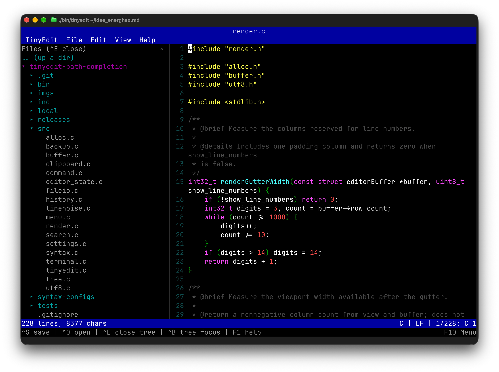
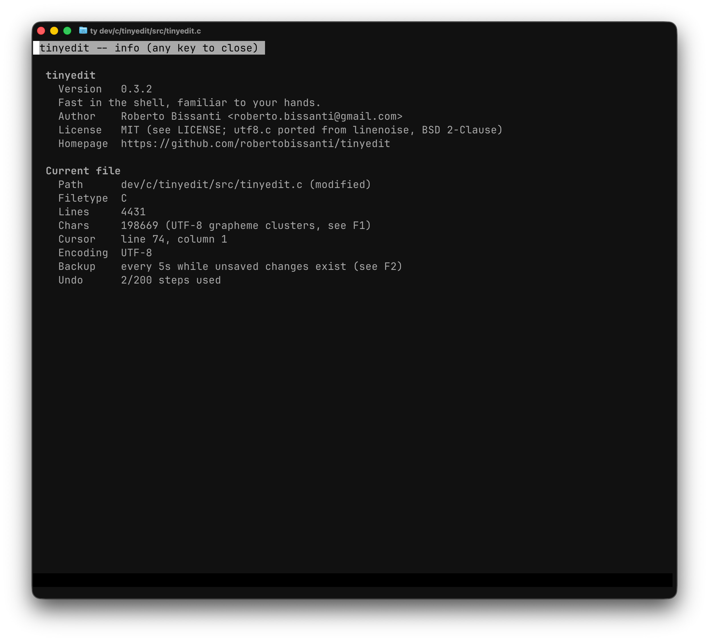
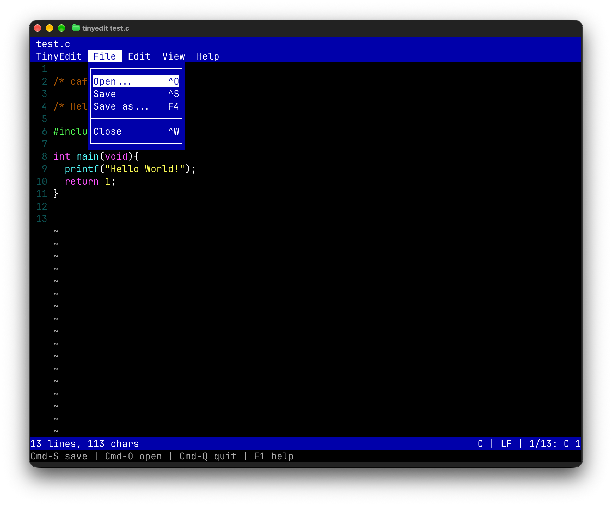
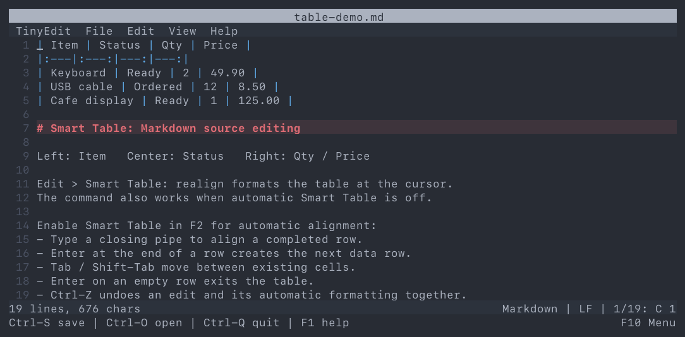
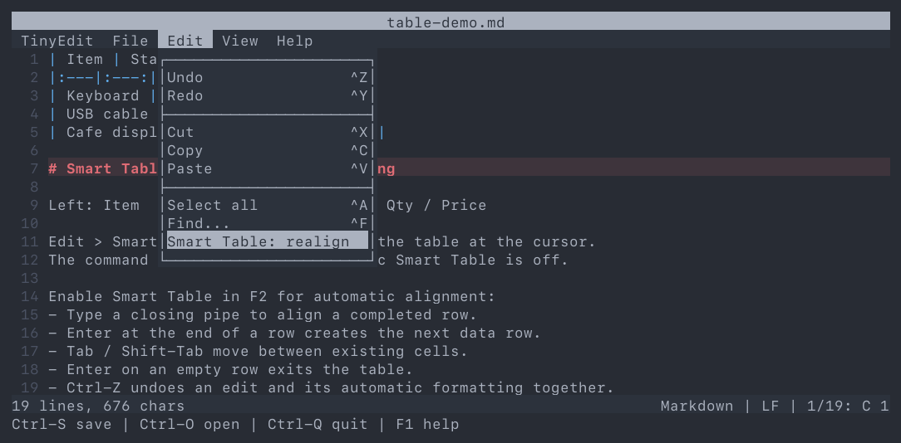
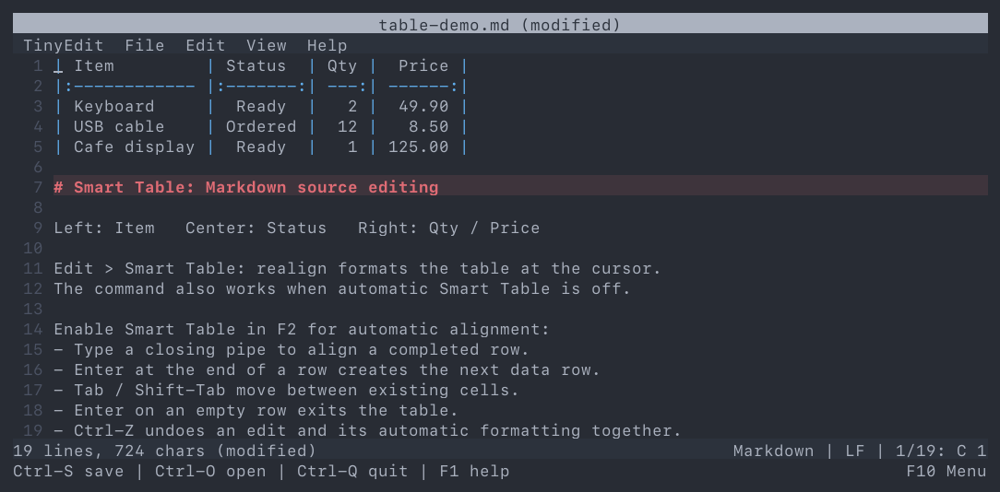

# User guide

[Documentation index](README.md) · [tinyedit overview](../README.md)

## Contents

- [System clipboard on Linux](#system-clipboard-on-linux)
- [Keyboard shortcuts](#keyboard-shortcuts)
- [Experimental macOS Command keys in Ghostty](#experimental-macos-command-keys-in-ghostty)
- [Opening and closing files](#opening-and-closing-files)
- [File tree sidebar](#file-tree-sidebar)
- [File information](#file-information)
- [Fast terminal paste](#fast-terminal-paste)
- [Mouse support](#mouse-support)
- [Links and installed documentation](#links-and-installed-documentation)
- [Markdown images](#markdown-images)
- [Markdown heading, attribute and block targets](#markdown-heading-attribute-and-block-targets)
- [Menus](#menus)
- [Smart Table](#smart-table)
- [Indentation and tabs](#indentation-and-tabs)
- [Automatic pair and tag closing](#automatic-pair-and-tag-closing)
- [Soft wrapping and navigation](#soft-wrapping-and-navigation)
- [Markdown display and live preview](#markdown-display-and-live-preview)
- [Top and status bars](#top-and-status-bars)
- [UTF-8 text](#utf-8-text)
- [Find and replace](#find-and-replace)
- [Backup and crash recovery](#backup-and-crash-recovery)

[Back to top](#user-guide)

## System clipboard on Linux

Ctrl-C/X/V use external clipboard tools when available: `wl-copy` and `wl-paste`
on Wayland, or `xclip` on X11. On Arch Linux with KDE/Wayland, install
`wl-clipboard` with `sudo pacman -S wl-clipboard`, then restart tinyedit.
For X11, install `xclip` instead. These are optional runtime tools; compiling
tinyedit does not require them. Installation does not require them either:
`make install` installs only tinyedit and never invokes `pacman` or another
package manager. Install the appropriate clipboard tool yourself if you want
Ctrl-C/X/V to share text with other applications. Without it, these shortcuts
use only tinyedit’s internal clipboard.

If no tool is available, or access to the display fails, tinyedit falls back
to its internal clipboard, shared only within the current editor session.
Check `command -v wl-copy wl-paste` and run `wl-paste --no-newline` after copying
text from another application to diagnose Wayland access. Terminal-native paste
(such as Ctrl-Shift-V in Konsole) uses bracketed paste and does not require these tools.

[Back to top](#user-guide)

## Keyboard shortcuts

- Arrows, Home, End, PageUp/Down: Move cursor

- `Ctrl+Home` / `Ctrl+End` (or `Ctrl+PageUp` / `Ctrl+PageDown`): Jump to the
  start/end of the file

- `Alt+←` / `Alt+→` (or `Esc b` / `Esc f`): Jump by word

- `Shift+Arrows` / `Shift+PageUp` / `Shift+PageDown` / `Shift+Home` /
  `Shift+End`: Extend/start text selection (doesn't work on macOS
  Terminal.app; use `Ctrl-T` instead)

- `Ctrl-T`: Toggle selection mode (extends selection with plain arrows,
  PageUp/PageDown, and Home/End; useful in terminals such as Terminal.app
  where Shift+Arrows is unsupported)

- Enter: New line (inherits the previous line's indentation if `auto_indent`
  is on)

- Tab: Indent (spaces or a literal tab, see `insert_spaces_for_tab`); with a
  selection, indents every selected line one level

- `Shift+Tab`: Outdent the selected lines, or the current one when there's no
  selection

- `(` `{` `[` `"` `` ` `` `$`: Auto-close the pair / skip over an existing
  closer / wrap the selection (if `auto_close_pairs` is on)

- `'`: Same, but only when `auto_close_single_quote` is on (off by default,
  since apostrophes in prose are more common than pairs)

- `>` in `.xml`, `.html`, or `.htm`: Auto-insert the matching closing tag
  (with `auto_close_pairs` on); HTML void elements such as `img` and `br` are
  left unclosed

- Backspace / Delete: Delete a character (UTF-8 aware)

- `Ctrl-A`: Select all

- `Ctrl-C` / `Ctrl-X` / `Ctrl-V`: Copy / cut / paste (system clipboard; C/X
  need an active selection)

- `Ctrl-Z`: Undo

- `Ctrl-Y`: Redo

- `Ctrl-F`: Incremental search (Arrows for next/previous match, `Ctrl-G` to
  toggle regex search, `Ctrl-R` to switch to search & replace, Esc to cancel)

- `F1`: Help screen listing every shortcut (any key closes it)

- `F3`: Info screen: version, author, and stats about the current file

- `F2`: Settings panel (Up/Down to navigate, Enter/Space to edit, Left/Right
  to cycle options, `Ctrl-D` resets defaults, `Ctrl-S` saves and exits, Esc
  exits with a confirmation prompt if there are unsaved changes)

- `F10`: Open or close the menu; use arrows to navigate, Enter to choose, or
  Esc to dismiss

- `Ctrl-S`: Save (asks for a filename if none is set)

- `F4` (or `Ctrl-Shift-S` where the terminal sends it): Save as: always asks
  for a filename; replacing another existing file requires confirmation

- `Ctrl-E`: Show or hide the file tree. Opening focuses the tree.

- `Ctrl-B`: Switch focus between the visible file tree and document.

- `Ctrl-O`: Open another file by entering its path; offers to save the current
  file first. A missing path becomes a new file on first save.

- `Ctrl-N`: New empty unnamed document; offers to save the current document
  first.

- `Ctrl-W`: Close the current file without quitting tinyedit; offers to save
  first and leaves an empty buffer.

- `Ctrl-Q`: Quit (if there are unsaved changes, asks y/n/Esc: save-and-quit /
  quit without saving / cancel)

[Back to top](#user-guide)

## Experimental macOS Command keys in Ghostty

In Ghostty, tinyedit can optionally accept macOS Command shortcuts, including
`Cmd-N`, `Cmd-S`, `Cmd-Z`, `Cmd-C`, `Cmd-X`, `Cmd-F`, and `Cmd-Q`, through the Kitty
keyboard protocol. Enable **macOS Command keys (Ghostty, experimental)** in
`F2`, or set `mac_command_keys = true` in `~/.tinyeditrc`, then reload
Ghostty with `Cmd-Shift-,`.

This Ghostty-specific mode is off by default because terminal programs do not
normally receive macOS Command-key events. While it is active, tinyedit
handles application shortcuts such as `Cmd-W`, `Cmd-Q`, and `Cmd-F`, and makes
`Cmd-C` and `Cmd-X` operate on its internal selection rather than the terminal
buffer. `Cmd-V` remains the terminal's native paste shortcut. Keyboard state
and the bindings managed by tinyedit are restored on exit, so no sequences
leak into the shell. Remove any older manual `super+...` keybind bridges from
your Ghostty configuration to avoid conflicts.

[Back to top](#user-guide)

## Opening and closing files

Start with `tinyedit folder` to edit an empty unnamed document in that folder.
The sidebar is visible and rooted there, while keyboard focus stays in the
document. Relative paths in Open and Save resolve from the supplied folder;
absolute paths, relative paths and symlinks to directories are supported.
A folder that cannot be entered or listed still reports an error.

File → New (`Ctrl-N`) starts an empty unnamed document after the shared
save/discard/cancel check. Cancel or save failure keeps the current document,
selection and view. Success clears history, search and backup state, preserves
the sidebar tree and returns focus to the document. It is inactive in prompts
and Settings. Cmd-N uses the existing opt-in experimental Ghostty Command-key
mode. Real-terminal verification of the new bindings is still required.

tinyedit keeps one active document at a time, but changing files does not
require restarting the program. `Ctrl-W` closes the current document and
returns to an empty unnamed buffer. `Ctrl-O` asks for a path and replaces the
current document with that file. Before either operation, unsaved changes get
the same save/discard/cancel check used by `Ctrl-Q`; cancelling or failing to
save leaves the current document untouched. If the path entered for `Ctrl-O`
does not exist, tinyedit opens an empty buffer under that name and creates the
file when it is first saved.

Save as asks before replacing an existing file other than the current document.
Press `y` or `Y` to replace it; any other key cancels and preserves the destination
and the current document name. Saving to the file already open, including another
path to the same device and inode, does not ask for ordinary overwrite confirmation.
While the editor is open, tinyedit checks the file on disk about once per second.
If another program changes or replaces it, press `r` to reload the disk version
or `k` to keep the editor copy. Reloading discards unsaved edits. After keeping
the editor copy, saving over a changed disk version asks for explicit confirmation;
declining leaves both copies intact. Detection uses file identity, size and
high-resolution modification/change times, so changes that preserve all of those
metadata values may go unnoticed.

In the Open, Save as, and first-save prompts, press **Tab** to complete file
and folder names. Repeated Tab presses cycle matching names alphabetically;
folders get a trailing `/`. Typing or deleting starts a new completion.
Relative paths, absolute paths, `~/`, spaces, and UTF-8 names are supported.
Hidden names are offered when the last component starts with `.`. You can
still type a new filename when saving.

[Back to top](#user-guide)

### Missing symbolic-link targets

Opening or saving through a symbolic link whose target does not exist reports
an error. tinyedit preserves the link and does not create its missing target;
a failed save preserves the document and its unsaved state. Links to existing
files continue to save through to the real target. Editor message-bar errors
are shown in red; ordinary prompts and successful results use the normal color.

[Back to top](#user-guide)

## File tree sidebar



Press `Ctrl-E` to show the filesystem tree on the left, rooted at the directory
where tinyedit started. Press `Ctrl-E` again to hide it. `Ctrl-B` switches focus between the tree and
the document while keeping the sidebar visible. Click either pane to focus it when mouse
support is enabled. The sidebar stays visible while editing.

In the tree, Up/Down move one entry at a time. PageUp/PageDown move by one
visible page; Home selects the first entry (`..`), and End selects the last
entry, scrolling it into view. Right on a folder makes it the new root of the tree. A single mouse click
on a folder name or triangle expands or collapses it; a double click makes
it the new root. Left collapses a
folder or selects its tree parent.
A single click selects a file; double-click opens it.
Enter toggles a folder or opens a file; Space also toggles a folder. Opening
a file uses the usual save/discard/cancel
confirmation for unsaved changes. Esc returns to the document; Tab keeps its normal indentation behavior
in the document. `r` reloads the tree,
`g` opens a path prompt: type a directory and press Enter to make it the
new tree root, or Esc to cancel. Up from the root selects `.. (up a dir)`;
Enter or a double click on that entry goes up one directory. Left collapses
folders or selects their tree parent without changing the root. `Ctrl-C` copies the selected path.

Close the sidebar with `Ctrl-E` from either pane, the `×` in its header when mouse
support is enabled, or **View → Show/hide file tree**. Folders are sorted before
files. Expansion loads one level at a time on request. Symlinks to directories use
the same triangle, expansion and navigation as folders, while keeping the
distinct symlink color.
Double-click or Right on a directory symlink makes its target the new root.
Sidebar colors reuse the configured syntax palette: keyword for directories
and the parent entry, preprocessor for symlinks and the root, and normal text
for files, even when syntax highlighting is disabled.
The sidebar grows up to half the terminal width, shifts deep indentation left,
and abbreviates long names in the middle while retaining their extensions.
The top bar keeps showing the current document name and modified indicator
while navigating the tree. Below 40 terminal columns the sidebar is temporarily hidden.

PNG and other binary files containing NUL bytes are rejected on opening,
leaving the current document intact. Malformed UTF-8 text remains editable.
On macOS, opening a kDrive Lite Sync file that is only in the cloud asks kDrive
to download its contents before tinyedit checks whether the file is text.

Sidebar hints follow the focused pane and return after temporary messages
expire. Closing the tree restores the document shortcuts in the bottom bar.

[Back to top](#user-guide)

## File information



*The `F3` screen summarizes the program version and the current file without
leaving the editor.*

[Back to top](#user-guide)

## Fast terminal paste

Pasting text directly into the terminal (Cmd+V or right-click, not
just the editor's own `Ctrl-V` which reads the system clipboard) is
handled via [bracketed
paste](https://en.wikipedia.org/wiki/Bracketed-paste): pasted text is
inserted in one shot instead of character by character, so it's
instant even for thousands of lines, and it doesn't trigger auto-close
on parentheses/quotes/backticks that happen to be in the pasted text
(which would otherwise be treated as if the user had typed them one at
a time). This requires terminal support for the protocol, which is available
in virtually every modern terminal, including Ghostty, iTerm2, and Terminal.app.
If paste feels slow inside `tmux` or `screen`, ensure bracketed-paste
passthrough is enabled in the multiplexer.

[Back to top](#user-guide)

## Mouse support

Mouse support (`mouse_enabled`, F2 panel, **off by default**) lets you
click to place the cursor, double-click a word to select it (or a link to
open it), drag with the left button to select text,
Shift-click to extend a selection, and scroll with the wheel. It is opt-in
because it overrides the terminal's native text selection, such as
`Cmd-C`/`Cmd-V` in Ghostty, and directs mouse events to tinyedit while enabled.
The change takes effect
immediately: toggling it in `F2` and pressing `Ctrl-S` applies it
right away, no restart needed.

Scrolling with the wheel leaves the cursor in place. The viewport stays at
the scrolled position while you move the pointer or hover over links, even if
the cursor is off-screen. Keyboard input, a text click or a drag resumes
following the cursor.

[Back to top](#user-guide)

## Links and installed documentation

Installed guides are read-only, including linked pages and guides opened with
Ctrl-O. You can navigate, search, select and copy text. Editing, replacing,
cutting, pasting and saving report a red error. The title and status bar show
`(read-only)`. Ctrl-N starts an editable document; Ctrl-O opens your own file.

`make install` includes the guides. Choose **Help → Documentation** to open
`$(PREFIX)/share/tinyedit/docs/README.md`, or the personal copy at
`~/.tinyedit/docs/README.md` if present, as an ordinary,
editable Markdown document. The installer includes linked images, reference
syntax/color scheme files, and contributor/test guides in the same relative
layout. For optional personal guides run `make install-docs` without `sudo`;
that target updates reference copies without changing personal `syntax/` or
`color-scheme/` files. Packagers can set `DATADIR` for shared resources and
`DESTDIR` for staging; only `DATADIR` is compiled into the editor.

Place the cursor on the label or destination of an inline Markdown link and
press **Alt+Enter**, or double-click it with mouse support enabled. Bare
`http://` and `https://` URLs also work. The message bar shows
`Alt+Enter open link` while over a link; temporary messages and prompts take
priority. Alt+Enter is ignored inside text-entry prompts. Its `Esc` + carriage
return sequence has been confirmed on Ghostty/macOS and ArchLinux. With
Kitty keyboard mode enabled, Ghostty sends `CSI 13;3u` instead; both forms
open links, including when experimental macOS Command keys are enabled.

Local links resolve relative to the current file (or the working directory
for an unnamed document). They accept percent-encoded paths, angle-bracket
paths containing spaces, and Markdown fragments described below.
Directory links open their `README.md`. Switching files uses the usual
save/discard/cancel confirmation: cancellation, failed saving, missing targets
and unreadable files keep the current document. Same-document fragment links
move the cursor without replacing the document.

Web links open the system browser using `open` on macOS or `xdg-open` on Linux,
with a literal argument vector after explicit confirmation. tinyedit reports a
missing launcher but cannot confirm whether the browser subsequently loads the
page. Web URLs with an empty host or ambiguous `user@host` authority are refused.
Inline `mailto:` links
open the configured mail composer using `open` on macOS or `xdg-email` on Linux;
tinyedit asks first and does not send mail. The address and optional URI parameters (for example,
percent-encoded subject/body) are passed unchanged as one argument. This needs
a desktop mail handler; starting the launcher does not confirm account setup
or successful composition. Other URI schemes are unsupported. Reference-style Markdown links, HTML links, duplicate-heading
suffixes and Setext heading anchors are not yet supported.

[Back to top](#user-guide)

### Markdown images

Markdown images such as `{#fig:diagramma}` open their local source
file in the operating system's default application (`open` on macOS,
`xdg-open` on Linux). Relative paths use the Markdown document's directory;
spaces, UTF-8, percent encoding and escaped parentheses work as for other local
links. A source fragment is ignored when opening the image file. Only regular files with a matching image extension and header (PNG, JPEG, GIF, WebP, BMP,
TIFF, HEIC, AVIF, ICO) and without execute permission are offered for opening.
SVG is excluded because it can contain active content. The editor asks for
confirmation before launching an external application; the image signature is
only a preliminary check, not a complete safety or validity guarantee. Missing files,
directories and launcher failures produce red errors. Opening an image keeps
the current document and its unsaved changes, without a document save prompt.
Use Alt+Enter or double-click on the image label or destination; in live preview,
hover the visible destination to highlight it and single-click to open it.
Remote HTTP(S) image destinations open in the browser. tinyedit does not render
images inline; successful launch does not confirm the external application
displayed the image. Ordinary text-file links still open inside tinyedit.
Opening the image destination is separate from following a link to its Pandoc
ID: `#fig:diagramma` jumps to the image source within the Markdown document.
For language-aware code blocks, see the [fenced-code guide](syntax-highlighting.md#fenced-code-blocks).

[Back to top](#user-guide)

### Markdown heading, attribute and block targets

Existing links such as `[Settings](#settings-and-appearance)` still reach
`## Settings and Appearance`. A trailing Pandoc attribute group does not become
part of the heading slug. Explicit Pandoc IDs are checked first, exactly and
case-sensitively; only when no explicit ID matches does tinyedit try the existing
ATX heading slug. Fragments retain percent decoding.

These explicit targets can be reached with `[Dati](#dati)` or the corresponding
ID in another file, such as `[Diagramma](altro.md#fig:architettura)`:

```markdown
## Titolo {#dati}

[Dati sperimentali]{#esperimento}

{#fig:architettura}

::: {.diagramma #architettura title="Diagramma"}
Contenuto del blocco.
:::
```

ID attributes may appear alongside classes and quoted or unquoted properties.
Spans and inline images require attributes immediately after the construct;
header attributes must finish the heading line. The destination is the heading
text, span text, image source or beginning of the fenced Div.

Obsidian paragraph block IDs use a space before a trailing marker:

```markdown
Questo paragrafo contiene i dati. ^dati

[Vedi i dati](#^dati)
```

For a structured block, put the marker on its own line, separated by a blank
line on both sides (the end of the document also terminates the marker). For example:

```markdown
| Nome | Valore |
|------|--------|
| A    | 10     |

^tabella-dati

[Vedi la tabella](#^tabella-dati)
```

The jump reaches the standalone marker's own line. A marker can also appear
at the beginning of a document, without a preceding block.
Inline paragraph markers retain their association with the paragraph or list
item. For a jump to the beginning of a structured block, use a heading or a
Pandoc span/Div ID. Navigation is a conservative source scan, not a complete
parser for arbitrary nested blocks.
Obsidian IDs contain only ASCII letters, digits and hyphens. `#^id` searches
only Obsidian block IDs; it never falls back to a heading or Pandoc ID.
Cross-file block links work too: `[Tabella](altro.md#^tabella-dati)`.
Duplicate explicit targets in the requested namespace and missing destinations
produce an explicit error rather than selecting a target arbitrarily.

Bare local references such as `@dati`, `@fig:architettura` and
`[@fig:architettura]` use the same opening gestures as links: Alt+Enter or a
mouse double-click, and a single click in compact Markdown live preview.
They are navigable only when that Pandoc ID exists in the current document;
email addresses and bibliography citations without a local target stay text.
References accept letters, digits, underscores, hyphens, namespace colons and
UTF-8 text; sentence punctuation is separate from the reference. A Pandoc ID
containing a period can be reached with an explicit `(#id.with.period)` link;
periods are not part of bare `@id` references.

This is navigation in the Markdown source, available independently of live
preview. Code fences and inline code do not define targets or references.
tinyedit does not execute Pandoc, generate figure numbers, load filters or
render images. HTML IDs, Kramdown attributes, wikilinks, reference-style images
and a complete Pandoc or Obsidian parser are outside this subset. See the
[Pandoc attribute syntax](https://pandoc.org/MANUAL.html#extension-header_attributes),
[Pandoc spans and Divs](https://pandoc.org/MANUAL.html#divs-and-spans) and
[Obsidian block convention](https://obsidian.md/help/links#Link%20to%20a%20block%20in%20a%20note).

[Back to top](#user-guide)

### Direct anchor links and bare fragments

`[nota](#^diag)` and `(#^diag)` follow the same Obsidian block ID. A standalone
`^diag` separated by blank lines is reached on its own line, even after many
empty lines. An inline marker such as `Paragraph text. ^diag` still targets
that paragraph's beginning. A literal backslash in `[nota]\(#^diag)` escapes
the opening parenthesis; omit it to make the label navigable.

`[Testo][#link]` and `![Testo][#link]` are tinyedit direct-anchor shortcuts:
they jump to `link` in the current document. An image with a fragment-only
destination, such as ``, also jumps internally. For portable
Markdown use `[Testo](#link)`; general reference definitions such as
`[Testo][ref]` followed by `[ref]: destination` are not supported.

[Back to top](#user-guide)

## Menus

The menu bar is visible below the optional top bar by default. Press `F10` to
open it, use Left/Right to switch menus and Up/Down to select a command, then
press Enter to run it or Esc to close it. With `mouse_enabled` on, you can
click a menu, hover over items or another menu to change the selection, and
click an item to run it; clicking outside closes the open menu.

`TinyEdit` contains Info, Settings, and Quit; `File` has file operations;
`Edit` has editing commands and Find; `View` has checked switches for line
numbers, the top bar, the menu itself, invisible characters, syntax
highlighting, automatic indentation, and cursor blinking; and `Help`
contains the shortcut reference and Documentation. Existing keyboard shortcuts appear beside
commands, with `^` meaning Ctrl (for example, `^S` means `Ctrl-S`). The
`F10 Menu` hint in the bottom message bar also opens the menu when clicked.

To hide the menu bar, turn off **Enable F10 menu** in `F2` Settings or set
`show_menu = false` in `~/.tinyeditrc`. `F2` remains available to turn it back
on.



*The File menu shows commands and their keyboard shortcuts.*

[Back to top](#user-guide)

## Indentation and tabs

With `auto_indent` on (default), Enter copies the leading
whitespace of the line you're moving away from, so continuing to type
keeps the same indentation level without retyping it by hand. With
`insert_spaces_for_tab` on (default), the Tab key inserts `tab_stop`
spaces instead of a literal tab character.

With an active selection, Tab indents every selected line one level and
`Shift+Tab` outdents them; with no selection, `Shift+Tab` outdents the
current line. Each press is a single undo step, and the selection stays
put afterwards so the shortcut can be repeated. Outdent accepts
whatever indentation the file already uses rather than only the flavor
tinyedit would produce: a leading tab counts as one full level,
otherwise up to `tab_stop` spaces are removed, stopping at the first
non-space so a partially indented line only loses what it has.

[Back to top](#user-guide)

## Automatic pair and tag closing

With `auto_close_pairs` on (default), typing `(`, `{`, `[`, `"`,
`` ` ``, or `$` inserts the matching closing character automatically
with the cursor left in between; typing the closer by hand when the
next character is already that closer skips over it instead of
duplicating it (except for `` ` ``, see below); with an active text
selection, typing an opening character wraps the selection in the
pair instead of replacing it. The single quote `'` has its own switch,
`auto_close_single_quote`, off by default: in prose an apostrophe
(`don't`, `user's`) is far more common than a matching pair, so
auto-closing it gets in the way in a manner `(` or `"` doesn't. Curly quotes (`«»`, `""`, `''`) behave
the same way as the other pairs, even when composed via an OS
compose sequence or pasted rather than typed directly, since none of
them exist on a standard keyboard. `$$` (LaTeX display math, typing
`$` four times in a row) is recognized as a special case of the `$`
pair: it opens `$$...$$` instead of nesting a second pair. One more
Right arrow after the sequence exits the nested structure entirely.
The single backtick `` ` `` is the one exception to skip-over: typing
it always opens a fresh pair instead of skipping past an existing
closer, because in Markdown a lone backtick is also valid syntax on
its own (inline code) typed several times in a row on the same line,
not only as this pair's closer. The triple-backtick Markdown code
fence (`` ``` ``) is intentionally not auto-closed, as auto-closing
multi-line fences often interferes with regular editing.

When the cursor is on or immediately after `(`, `)`, `[`, `]`, `{`, or `}`,
tinyedit highlights that bracket and its matching partner using the selection
color. It follows nested brackets across lines and works on existing or pasted
text too, independently of `auto_close_pairs`. Matching uses the text itself;
it does not distinguish brackets inside strings or comments. Quotes, backticks,
and `$` are not included in this highlight.

In `.xml`, `.html`, and `.htm` files, typing `>` immediately after an
opening tag also inserts its matching end tag and leaves the cursor between
the two: `<section>` becomes `<section>|</section>`. This uses the same
`auto_close_pairs` setting. XML self-closing tags such as `<item/>` are left
alone. For HTML, tinyedit also recognizes the standard void elements —
`area`, `base`, `br`, `col`, `embed`, `hr`, `img`, `input`, `link`, `meta`,
`param`, `source`, `track`, and `wbr` — and does not add an invalid closing
tag for them. XML has no such void-element rule, so `<br>` in an XML document
correctly becomes `<br>|</br>`.

[Back to top](#user-guide)

## Soft wrapping and navigation

Lines too long for the screen width always wrap (soft-wrap is always
on, there's no horizontal scrolling), breaking on a space where
possible. `soft_wrap` (`0` by default, meaning no extra limit beyond
the window edge) sets an optional column cap narrower than the window, which
helps keep lines readable on ultra-wide displays. Up/Down and
PageUp/PageDown always move by *visual* row rather than file row, so
moving down a long line advances one visual segment at a time instead
of jumping the whole line. Home/End follow the same convention by
default (`home_end_visual_line = true`, VS Code/Sublime style); set to
`false` (vim style) they always go to the start/end of the whole
*logical* line, regardless of how many visual rows it wraps into.

`scrolloff` controls cursor context while navigating long text: it keeps
that many visual rows above and below the cursor where possible. Its default
is `0`, which keeps the current edge-following behavior; values from `1` to
`20` progressively keep the cursor away from the top and bottom of the view.
Near the start or end of a file the viewport remains clamped to available
text, so the requested margin may be smaller.

[Back to top](#user-guide)

## Markdown display and live preview

Link-label highlighting follows at most 16 nested levels. Deeper labels stay
literal, so crafted nesting cannot exhaust the call stack; file bytes are unchanged.

Enable **Markdown bold and italic** in F2 (or set
`markdown_text_styles = true` in `~/.tinyeditrc`) to render Markdown emphasis
with bold/italic terminal attributes and headings in bold. Markup remains
visible and editable; syntax highlighting must be enabled. The option is off
by default and combines with heading reverse video.

Enable **View → Markdown live preview**, or the same option in F2
(`markdown_live_preview = true` in `~/.tinyeditrc`), for a compact Markdown
view. Paired single-line `**bold**` / `__bold__` and `*italic*` / `_italic_`
keep their terminal styles while hiding their delimiters. Inline `[label](https://example.org)`
links display an underlined label. For bold and italic, placing the cursor
inside the construct or at either boundary reveals its complete source for
editing; moving away compacts it again. For links, enter source editing by
placing the cursor at the left or right boundary. Moving directly into a link
label keeps it compact until a boundary is reached. Once expanded from a
boundary, the link stays editable while the cursor remains inside it,
including its destination. While typing or pasting a link, source editing stays
active so that automatically inserted parentheses do not hide the destination
being entered. Empty destinations remain literal text.

With mouse support enabled, hovering over a compact link changes its color.
A single click on its label follows the link without moving the cursor into
its source or expanding it. Clicking immediately after the label enters source
editing from its right boundary; arrow keys can reach either boundary.
Shift-click and selection retain their editing behavior. Outside live preview,
links retain their existing double-click and Alt+Enter actions.

This also works with wrapping, Unicode text,
and mouse positioning; the document and saved bytes are unchanged.

Live preview is off by default and works even with syntax highlighting disabled.
With highlighting off, delimiters still collapse, editing boundaries and link
actions remain available, and syntax colors stay off. It enables
bold and italic attributes independently of **Markdown bold and italic**.
Selection and active search results temporarily reveal the full source.
This is a partial view using the existing tokenizer: headings, images, code,
front matter, math, incomplete or multiline emphasis, and reference-style
links retain their source markup. Nested Markdown formatting is not parsed.
Terminal support determines the appearance of bold, italic and underline.

In ANSI mode, for Markdown ATX headings (`#` through `######`), enable **Reverse Markdown
heading colors** in F2, or set `markdown_heading_reverse = true` in
`~/.tinyeditrc`. This swaps the existing heading foreground and editor
background using terminal reverse video, including right-hand padding,
and wrapped continuations. Line numbers keep their normal style. Syntax highlighting must be enabled. Code fences,
front matter, and math blocks retain their ordinary appearance. Set the option
to `false` to disable it. Setext headings (`===` or `---`) are not covered.

In RGB mode, Colors replaces the Markdown reverse-heading toggle with
`rgb_markdown_heading_background = #RRGGBB`. The default `terminal-default`
disables the heading-specific background and keeps the editor background.
Heading text continues to use `rgb_syntax_preprocessor`; ANSI retains
`markdown_heading_reverse`. Old configurations retain their ANSI behavior.


Selection and search highlighting take precedence over Markdown heading
reverse video and inline bold/italic styles, including selected newline cells.
The empty area to the right of an ATX heading retains its heading background.

[Back to top](#user-guide)

## Top and status bars

The filename and modified indicator are centered in the optional top bar.
The optional top bar (`show_top_bar`) shows only the filename (without its directory path) and
unsaved-changes state as a persistent title. Its text and background use the
reverse of the configured status bar colors, whether the menu is visible or hidden.
This is useful on long files
where you lose track of position while scrolling. When it's on, the
filename doesn't repeat in the bottom status bar (which then shows
only line/char counts); when it's off, the filename shows up there
instead. The unsaved-changes indicator is always visible in the
bottom bar either way. The bottom bar also shows the cursor's actual
source byte column, on the right (`line/total: C column`) next to the line number.

[Back to top](#user-guide)

## UTF-8 text

UTF-8 support includes code point decoding, grapheme cluster boundaries
(emoji with modifiers, ZWJ, combining marks), and display width (0/1/2
columns) for the cursor, backspace, and rendering, not just European accented
characters but CJK and emoji too. The status bar's character count is
grapheme clusters, not raw bytes (a modified emoji counts as 1
character, not however many bytes it takes in the buffer).
The grapheme and width helpers began as a port from
[linenoise](https://github.com/antirez/linenoise); the bounded, strict decoder
is original to tinyedit and accepts only well-formed UTF-8, including `0x00`.
It rejects isolated continuation bytes, overlong encodings, surrogate code
points, values above `U+10FFFF`, and incomplete sequences. Each bad byte is
one cursor and deletion step, displayed as `�`; valid bytes after it are
decoded normally. Display never rewrites the file buffer. Saving an otherwise
unchanged file preserves its UTF-8 bytes and whether its final row has a newline.

[Back to top](#user-guide)

## Find and replace

Inside the Find prompt (`Ctrl-F`), `Ctrl-G` toggles whether the
search string is interpreted as a POSIX extended regular expression
(`<regex.h>` from libc, zero external dependencies) instead of a
literal string. The prompt shows `[regex]`/`[literal]` for the
current mode, updated the instant Ctrl-G is pressed. The mode isn't a
persistent setting: it resets to literal on every new search
(`Ctrl-F`). Switching to search-and-replace (`Ctrl-R`) keeps whatever
mode was chosen, shown there too.

In regex mode, replacement text understands `\n` (new line), `\t` (tab),
`\r` (carriage return), and `\\` (a literal backslash). This makes it
possible, for example, to search for the visible two-character sequence
`\\n` with the regex `\\\\n` and replace it with real line breaks by
entering `\n` in the replacement prompt. Other backslash sequences are
preserved literally.

The search/replace prompt adapts to available width in three stages,
always leaving room for the text being typed: it starts by spelling
out every shortcut (`Esc cancel, Arrows jump, Ctrl-R replace, Ctrl-G
regex`), shrinks to a short form (`Search [mode]:`) once the growing
query wouldn't leave room for both, and if even that isn't enough the
message bar scrolls to always show the most recent part of what's
being typed. The message's leading part (whatever is left of the
fixed instructions) is what disappears first.

[Back to top](#user-guide)

## Backup and crash recovery

Recovery backups are deliberately opt-in: `backup_interval = 0` disables
their creation, including during abnormal termination. An unnamed document
does not receive a recovery backup, even when the interval is enabled; it
must first be given a filename. These are intentional choices, not recovery
bugs. If the process terminates before saving, unsaved text without a recovery
copy can be lost; an existing saved file is separate from those unsaved edits.

If `backup_interval` (F2 panel, off by default) is set to a nonzero
value (5 seconds effective minimum), the editor periodically writes a
recovery copy of the buffer while there are unsaved changes, to
`~/.tinyedit/backup/` (never next to the original file). The copy is
removed automatically after a successful save or a clean exit. Its
mere presence the next time you open that file is the signal that the
previous session didn't close cleanly (crash, kill, terminal closed).
In that case the editor shows a full-screen warning (not just a
status-bar message, to avoid silently missing the chance to recover)
and asks whether to restore the changes before proceeding.

Save refuses pipes, devices and other special-file destinations, including
through symbolic links. Recovery rejects special files and NUL-containing data
without replacing the current document.

When tinyedit receives SIGTERM or SIGHUP, it restores the terminal and exits
with status 128 plus the signal number. It does not save unsaved edits on signal;
a backup exists only when the configured interval has produced one for a named
document. SIGKILL cannot be handled.

[Back to top](#user-guide)

## Smart Table

### Quick start: create a table

1. Open or save a document with a Markdown filename such as `notes.md`.
2. Press F2, enable **Smart Table**, and save the settings with F2 or Ctrl-S.
3. Type `| Item | Qty |` and press Enter at the end of the row. The first row
   becomes the header; tinyedit adds the separator and an empty data row.
4. Fill the cells, using Tab / Shift-Tab to move through existing cells. Enter
   at the end of a completed row adds the next data row.
5. Press Enter on an empty row to leave the table. Save the document with Ctrl-S.

To try an existing table, copy this source into your own Markdown file:

```markdown
| Item | Status | Qty | Price |
|:---|:---:|---:|---:|
| Keyboard | Ready | 2 | 49.90 |
| USB cable | Ordered | 12 | 8.50 |
| Cafe display | Ready | 1 | 125.00 |
```

Installed guides are read-only; use a separate editable document for practice.
Opening a table alone does not reformat it, even when Smart Table is enabled.

### Before and after realignment

Put the cursor anywhere in the table and choose **Edit → Smart Table: realign**.
The command works with the automatic setting both on and off. It adjusts the
entire contiguous table, not just the current row or selected cells.



*Before: valid source with uneven pipe positions and short separator cells.*



*Open Edit by mouse or through F10; select Smart Table: realign.*



*After: Item is left-aligned, Status centered, and the numeric columns
right-aligned. Delimiters expand to match the content. The modified indicator
means the result has not yet been saved; Ctrl-Z reverses the operation.*

These images render actual tinyedit v0.3.10 output captured in a 96 × 23 PTY,
using the shipped One Dark RGB theme with Markdown live preview off. Font and
terminal settings can change the appearance; this is source formatting, not a
separate graphical table view.

### Automatic editing and column alignment

With syntax highlighting enabled, structural table pipes and the second row's
alignment dashes/colons have a separate color, even when Smart Table is off.
Cell text, escaped pipes and inline/fenced code retain their syntax colors.
Choose **Syntax: Markdown table delimiters** in **F2 → Colors** to change it.

Enable **Smart Table** in F2, or set `smart_table = true` in `~/.tinyeditrc`.
It is off by default. In Markdown files, typing a real pipe separator or
pressing Enter at the end of a table row aligns the contiguous table. Start
with an outer pipe, separate cells with pipes, and close the row with a pipe.
The first row remains an editable header while its columns are being built.
Enter confirms it, creates the mandatory second delimiter row and prepares the
first data row below it. **Edit → Smart Table: realign** also creates a missing
delimiter, including for a lone header. Existing second-row text moves down;
no data is overwritten. Automatic alignment of multiple completed rows likewise
inserts the missing delimiter. Only the second row controls column alignment.

Delimiter cells are normalized as `| ----- |` (default left), `|:----- |`
(explicit left), `| -----:|` (right), or `|:-----:|` (center). Colons replace
the boundary padding spaces so the pipes remain aligned. The dash count follows
the displayed content width, grows or shrinks with it, and is at least three.
Existing short delimiters such as `:-:` are accepted and expanded. Excess dashes
do not force a column to stay wide. This follows the header/delimiter/body
structure of [GFM tables](https://github.github.com/gfm/#tables-extension-);
Smart Table retains its conservative recognition limits below.

Enter on a completed data row prepares the next row with the same number of cells. Enter again on an
empty row removes its pipes and leaves a normal blank line. Splitting within
cell content retains ordinary Enter behavior. Once the delimiter exists, Tab
and Shift-Tab move to the
next or previous cell and cross existing row boundaries; at the table ends
they stay in the current cell. A selection retains ordinary indent/outdent
behavior. Elsewhere Tab and Enter retain their existing meanings.

Use **Edit → Smart Table: realign** to format the table at the cursor even
with Smart Table disabled. This preserves selection and the cursor's byte
offset within cell content. Padding positions map to the nearest content
boundary. Each edit and its automatic formatting share one undo/redo action.
The command respects read-only documentation and reports errors in red.

### Recognition and limits

Recognition is deliberately conservative: rows must begin and end with an
outer pipe, have equal cell counts, and contain balanced inline backtick
spans. Indented rows, fenced code, incomplete rows, mismatched cell counts and
unmatched backticks are left alone. Escape-protected pipes and pipes inside
inline code remain cell content. Links, UTF-8, malformed bytes and literal
tabs retain their bytes; formatting adjusts padding and the second delimiter
row, inserting that row when needed.
Widths use the editor's Unicode helpers and tab stops; fonts may differ.
Tabs can constrain exact centering or right alignment.

Processing is limited to 128 cells per row, 1,024 contiguous rows, and 1 MiB of
source through the table's last row; formatted display width is also bounded
by 1 MiB. Smart Table checks the complete prospective result before applying
formatting, including the source prefix, mandatory delimiter and any new data
row from Enter. A result beyond the byte or row budget is rejected in red;
existing text and logical positions remain unchanged. A pipe already typed by
the user stays inserted and can be undone normally when its automatic alignment
is rejected. Unsupported/ambiguous input is left alone automatically; the
explicit command reports an error in red. No data is truncated. Scanning happens on separator/Enter/navigation actions, not every
ordinary character. Tables wider than 80 columns keep the existing soft-wrap
rendering: aligning source does not guarantee that a wide table fits or is
readable in the terminal. No dedicated wide-table renderer is provided.

Smart Table is implemented independently, with no dependency on
[vim-table-mode](https://github.com/dhruvasagar/vim-table-mode), whose interactive
creation and realignment behavior served as a functional reference. Tests
exercise decoded Tab/Shift-Tab events; they do not certify physical modified
keys in every terminal.

[Back to top](#user-guide)
